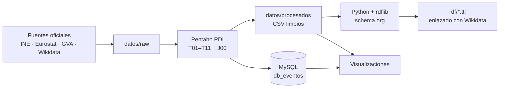

# Fallas y Hogueras: impacto de las fiestas en el turismo y la movilidad

Las **Fallas de València** y las **Hogueras de San Juan de Alicante** son las dos grandes fiestas de la
Comunitat Valenciana. Este proyecto mide cuánto aumentan los viajeros, la ocupación hotelera, el tráfico
aéreo y el transporte público en cada ciudad durante su fiesta. Para ello integra datos abiertos oficiales
(INE, Eurostat, Generalitat Valenciana y Wikidata) en un almacén de datos, los transforma a datos enlazados
con schema.org y los visualiza.

Práctica de la asignatura **Adquisición y Preparación de Datos** · Universidad de Alicante · Curso 2026-27.

---

## Índice

1. [Preguntas](#preguntas)
2. [Cómo se mide el impacto](#cómo-se-mide-el-impacto)
3. [Fuentes de datos](#fuentes-de-datos)
4. [Flujo de trabajo](#flujo-de-trabajo)
5. [Almacén de datos](#almacén-de-datos)
6. [Limpieza y carga con Pentaho](#limpieza-y-carga-con-pentaho)
7. [Datos enlazados (RDF)](#datos-enlazados-rdf)
8. [Visualizaciones](#visualizaciones)
9. [Estructura del repositorio](#estructura-del-repositorio)
10. [Cómo reproducirlo](#cómo-reproducirlo)
11. [Limitaciones y valores atípicos](#limitaciones-y-valores-atípicos)
12. [Autoras, licencia y referencias](#autoras)

---

## Preguntas

1. ¿Cuántos pasajeros más llegan a cada aeropuerto en el mes de su fiesta?
2. ¿Cuánto suben los viajeros, las pernoctaciones y el grado de ocupación hotelera durante Fallas y Hogueras?
3. ¿Aumenta el uso del metro y el autobús de València durante las Fallas?
4. ¿Cómo evoluciona la oferta de viviendas turísticas en las dos ciudades?
5. ¿Qué fiesta tiene más impacto si se tiene en cuenta el tamaño de cada ciudad?

## Cómo se mide el impacto

Ninguna fuente publica datos "de Fallas" ni "de Hogueras": todas son series mensuales de todo el año.
Por eso cada ciudad actúa como **grupo de control** de la otra:

| Fiesta | Mes | Ciudad sede | Ciudad de control |
|---|---|---|---|
| Fallas | marzo | València | Alicante |
| Hogueras | junio | Alicante | València |

En cada edición se calcula la variación del mes de la fiesta respecto a su mes de referencia, primero en la
ciudad sede y después en la de control. La diferencia entre las dos es el impacto que se atribuye a la fiesta
(**diferencias en diferencias**).

Comparar solo junio con mayo y julio no serviría en Alicante, porque en julio ya empieza la temporada de
playa. La ciudad de control descuenta ese efecto de temporada. La consulta está en
[`etl/sql/consulta_impacto_did.sql`](etl/sql/consulta_impacto_did.sql).

## Fuentes de datos

| Bloque | Fuente | Organismo | València | Alicante | Periodo | Granularidad | Licencia |
|---|---|---|:-:|:-:|---|---|---|
| Aeropuerto | [Air passenger transport by reporting airport (`avia_paoa`)](https://ec.europa.eu/eurostat/databrowser/view/avia_paoa/default/table) | Eurostat | Sí (`ES_LEVC`) | Sí (`ES_LEAL`) | 2015-01 a 2026-06 | Mes | CC BY 4.0 |
| Hoteles: viajeros y pernoctaciones | [EOH, tabla 2078](https://www.ine.es/jaxiT3/Tabla.htm?t=2078) | INE | Sí | Sí | 2015M01 a 2026M09 | Mes · residencia | Reutilización libre citando al INE |
| Hoteles: plazas y ocupación | [EOH, tabla 2076](https://www.ine.es/jaxiT3/Tabla.htm?t=2076) | INE | Sí | Sí | 2015M01 a 2026M09 | Mes | Reutilización libre citando al INE |
| Transporte público | [Estadística de Transporte de Viajeros, tabla 20193](https://www.ine.es/jaxiT3/Tabla.htm?t=20193) | INE | Sí (metro y autobús) | No disponible | 2015M01 a 2026M08 | Mes | Reutilización libre citando al INE |
| Viviendas turísticas | [Medición del número de viviendas turísticas (experimental)](https://ine.es/experimental/viv_turistica/exp_viv_turistica_tablas.htm) | INE | Sí | Sí | 2020M08 a 2026M05 | 13 mediciones | Reutilización libre citando al INE |
| Registro de viviendas turísticas | [Registro de viviendas de uso turístico](https://dadesobertes.gva.es/es/dataset/tur-gestur-vt) | Generalitat Valenciana | Sí | Sí | Altas 1993 a 2026 | Vivienda | CC BY 4.0 |
| Ciudades | [Wikidata](https://query.wikidata.org) (`Q8818`, `Q11959`) | Wikidata | Sí | Sí | Fecha de descarga | Ciudad | CC0 |
| Ediciones de las fiestas | `eventos.csv`, elaboración propia | JCF, Federació de Fogueres, Ayto. de Alicante, DOGV | Sí | Sí | 2015 a 2026 | Edición anual | CC BY 4.0 |
| Incidencias | `incidencias.csv`, elaboración propia | Fuentes citadas en cada fila | Sí | Sí | 2015 a 2026 | Periodo | CC BY 4.0 |

Todos los ficheros se descargaron el 5 de noviembre de 2026. En
[`datos/raw/registro_datos.csv`](datos/raw/registro_datos.csv) están, para cada fichero, la URL de origen,
la codificación, el separador, el formato de los números, los filtros aplicados al descargarlo, el periodo,
el número de filas, la licencia y los avisos.

**Enriquecimiento con Wikidata.** La consulta [`datos/raw/wikidata/wikidata.rq`](datos/raw/wikidata/wikidata.rq)
obtiene el código INE (`P772`), las coordenadas (`P625`), la población (`P1082`) y la superficie (`P2046`)
de las dos ciudades. Con estos datos se completa `DIM_CIUDAD`, y el código INE sirve para unir Wikidata con
las tablas del INE. Las fiestas también se enlazan con Wikidata: Fallas es `Q1143768` y Hogueras, `Q1236370`.

## Flujo de trabajo



## Almacén de datos

Es una **constelación de hechos**: tres tablas de hechos comparten las dimensiones de tiempo, ciudad, evento e
incidencia. Cada fila de hechos es un mes en una ciudad. `id_evento` e `id_incidencia` señalan si ese mes
hubo fiesta o alguna incidencia, y son nulos si no la hubo.

| Tabla de hechos | Medidas | Dimensiones propias |
|---|---|---|
| `HECHO_DEMANDA_HOTELERA` | viajeros, pernoctaciones, estancia media | `DIM_PROCEDENCIA` (residentes en España o en el extranjero) |
| `HECHO_OFERTA_ALOJAMIENTO` | establecimientos, plazas, grado de ocupación, altas en el registro | `DIM_TIPO_ALOJAMIENTO` |
| `HECHO_MOVILIDAD` | viajeros | `DIM_MEDIO_TRANSPORTE` (avión, metro, autobús) |

Dimensiones comunes: `DIM_TIEMPO` (año, trimestre, mes, temporada), `DIM_CIUDAD` (código INE, coordenadas,
población, superficie, QID de Wikidata), `DIM_EVENTO` (edición, fechas, duración, si se celebró, QID de
Wikidata) y `DIM_INCIDENCIA`.

Diseño conceptual, lógico y físico en [`almacen/`](almacen/). Script de creación en MySQL:
[`etl/sql/diseno_fisico.sql`](etl/sql/diseno_fisico.sql).

## Limpieza y carga con Pentaho

Hay 11 transformaciones y un job (`J00`) que las ejecuta en orden en Pentaho Data Integration. Con ellas se
cubren todas las tareas obligatorias del apartado:

- **Corregir errores**: formatos numéricos del INE (miles con punto, decimales con coma), codificaciones
  (UTF-8 con BOM, ISO-8859-1) y nombres de municipio distintos en cada fuente.
- **Valores ausentes**: datos marcados con `.` en el INE, meses sin publicar en Eurostat y ediciones suspendidas.
- **Redundancia**: filtrado por los códigos INE `46250` (València) y `03014` (Alicante) y eliminación de duplicados.
- **Nuevas características**: temporada, estancia media, duración de cada edición, marcas de mes de fiesta y
  de incidencia.
- **Enriquecimiento**: datos de las ciudades obtenidos de Wikidata.
- **Valores atípicos**: detección y tratamiento, con las incidencias conocidas como explicación.
- **Validación**: rangos del grado de ocupación, huecos en las series e integridad referencial antes de cargar.

Detalle de cada transformación en [`etl/README_ETL.md`](etl/README_ETL.md).

## Datos enlazados (RDF)

Los datos limpios se transforman a tripletas con [schema.org](https://schema.org) usando Python y `rdflib`:

| Recurso | Clase | Enlace externo |
|---|---|---|
| Fiesta y cada una de sus ediciones | `schema:Event` (con `superEvent`, `startDate`, `endDate` y `eventStatus` para las suspendidas) | `owl:sameAs` → Wikidata |
| Ciudad | `schema:City` (con `geo` y el código INE como `identifier`) | `owl:sameAs` → Wikidata |
| Valor mensual | `schema:Observation` | — |

El resultado está en [`rdf/`](rdf/), junto con la validación: número de tripletas, clases y propiedades
usadas, y consultas SPARQL de ejemplo.

## Visualizaciones

1. **Impacto por edición**: comparación entre la ciudad sede y la de control en cada edición de Fallas y Hogueras.
2. **Evolución mensual 2015–2026**: series de las dos ciudades con las fiestas y las incidencias marcadas.

Código y capturas en [`visualizaciones/`](visualizaciones/).

## Estructura del repositorio

```
├── datos/
│   ├── raw/                 Datos originales, tal como se descargaron
│   │   └── registro_datos.csv   Inventario de fuentes (URL, fecha, formato, licencia)
│   └── procesados/          CSV limpios generados por Pentaho
├── almacen/                 Apartado 3: diagramas conceptual y lógico
├── etl/                     Apartado 4: transformaciones (.ktr) y job (.kjb) de Pentaho
│   └── sql/                 Diseño físico y consulta de impacto
├── rdf/                     Apartado 5: script de tripletas y ficheros .ttl
├── visualizaciones/         Apartado 6
├── memoria/                 Apartado 7: memoria en PDF
├── LICENSE
├── requirements.txt         Librerías de Python
└── README.md
```

## Cómo reproducirlo

**Requisitos:** Pentaho Data Integration 9 o posterior, MySQL 8, MySQL Connector/J y Python 3.10 o posterior.

1. Clonar el repositorio.
2. Crear la base de datos ejecutando `etl/sql/diseno_fisico.sql` (por ejemplo, desde MySQL Workbench).
3. Copiar `mysql-connector-j-*.jar` en `data-integration/lib` y reiniciar Spoon.
4. Abrir `etl/J00*.kjb` en Spoon, definir la variable `DB_PASS` con la contraseña de MySQL y ejecutar el job.
5. Comprobar la carga con `etl/sql/consulta_impacto_did.sql`.
6. Generar las tripletas:
   ```bash
   pip install -r requirements.txt
   python rdf/<script>.py
   ```

Los datos originales ya están en `datos/raw/`. Si se quieren volver a descargar, las URL y los filtros de
cada fichero están en `registro_datos.csv`.

## Limitaciones y valores atípicos

- **COVID-19**: las Fallas de 2020 y las Hogueras de 2020 y 2021 se suspendieron. Las Fallas de 2021 se
  celebraron del 1 al 5 de septiembre, así que en marzo de 2021 no hubo fiesta. En el INE no hay datos
  hoteleros de mayo y junio de 2020.
- **Transporte público de Alicante**: el INE no publica datos del TRAM d'Alacant ni del autobús urbano de
  Alicante en una tabla comparable. Por eso la movilidad de las dos ciudades solo se compara con el
  aeropuerto, y el metro y el autobús se analizan solo en València.
- **Viviendas turísticas**: la estadística del INE no es mensual (13 mediciones), por lo que no sirve para
  medir el efecto de un mes concreto. En el registro de la GVA aparecen 109 altas con fecha de 1993, que
  probablemente es una fecha por defecto.
- **Incidencias que alteran las series**: la DANA de octubre de 2024 afectó a Metrovalencia y en marzo de
  2026 hubo huelga en el metro.
- **Eurostat**: falta enero de 2026 y aún no se han publicado los meses de julio a septiembre de 2026.
- Los datos de población y superficie de Wikidata son los vigentes en la fecha de descarga.

## Autoras

- Sama Al Adib
- Carla Carreras Villarejo
- Jordi Cantó Cartagena
- Alba García Calvete 

## Licencia

- **Código** (transformaciones, SQL y scripts): MIT. Ver [`LICENSE`](LICENSE).
- **Datos de elaboración propia** (`eventos.csv`, `incidencias.csv`, datos procesados y RDF): CC BY 4.0.
- **Datos de terceros**: conservan la licencia de su fuente original, indicada en la tabla de fuentes.

## Referencias

- Eurostat. *Air passenger transport by reporting airport (avia_paoa)*. https://ec.europa.eu/eurostat/databrowser/view/avia_paoa/default/table
- INE. *Encuesta de Ocupación Hotelera: puntos turísticos* (tablas 2076 y 2078). https://www.ine.es/jaxiT3/Tabla.htm?t=2078
- INE. *Estadística de Transporte de Viajeros* (tabla 20193). https://www.ine.es/jaxiT3/Tabla.htm?t=20193
- INE. *Medición del número de viviendas turísticas en España y su capacidad*. https://ine.es/experimental/viv_turistica/exp_viv_turistica_tablas.htm
- Generalitat Valenciana. *Registro de viviendas de uso turístico*. https://dadesobertes.gva.es/es/dataset/tur-gestur-vt
- Wikidata. *Query Service*. https://query.wikidata.org
- Junta Central Fallera. https://www.fallas.com
- Federació de les Fogueres de Sant Joan. https://hogueras.com
- schema.org. https://schema.org
- Candela, G. et al. (2024). *A reproducible framework to publish and reuse Collections as data: the case of the European Literary Bibliography*. https://doi.org/10.5281/zenodo.14106707
